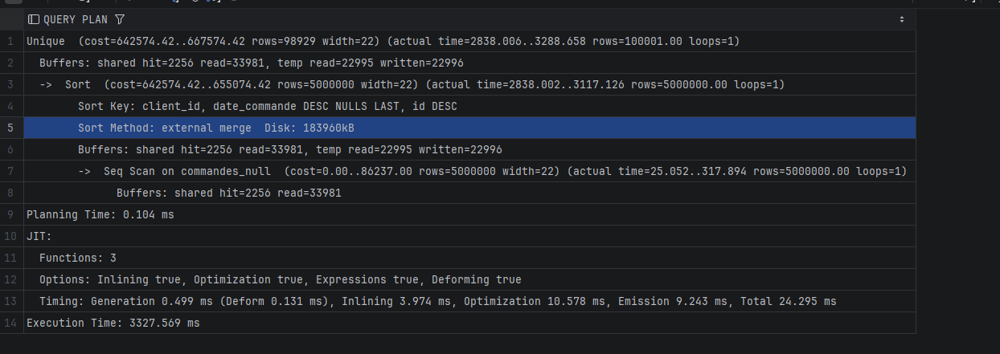
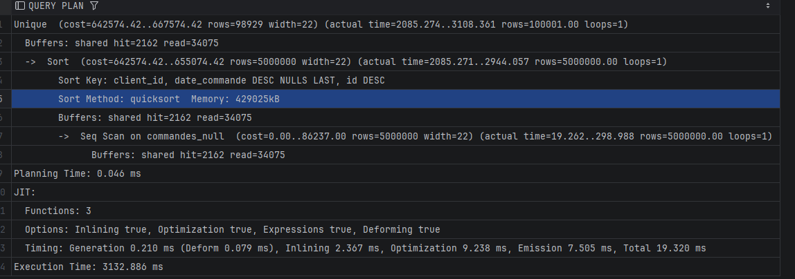

EXPLAIN ANALYSE
Select DISTINCT ON (client_id) client_id, date_commande, montant
FROM commandes_null
ORDER BY client_id, date_commande DESC NULLS LAST, id DESC

En faisant un explain analyse, on lit le plan de bas en haut :
Seq Scan (lit les 5 M de lignes) -> Sort (trie par client puis date) -> Unique (garde la 1re ligne de chaque client).

Lire actual time=A..B (en ms depuis le début de l'exécution) :
- A : le moment où le noeud renvoie sa première ligne à son parent
- B : le moment où il renvoie sa dernière ligne

Exemple (work_mem 256MB) :
Unique       actual time=2838..3289
  Sort       actual time=2838..3117
    Seq Scan actual time=25..318

Les temps sont cumulés : un noeud inclut le temps de ses enfants.
Pour avoir le temps propre d'un noeud, on retire le B de son enfant :
- Seq Scan : 318 ms
- Sort : 3117 - 318 = environ 2,8 s
- Unique : 3289 - 3117 = environ 170 ms
Le Sort fait environ 85 % du temps, c'est lui le coupable.

Seq Scan : A très petit (25 ms), il envoie les lignes au fil de l'eau.
Sort : A très grand (2838 ms), il est bloquant, il doit tout recevoir et tout trier
avant de renvoyer la première ligne.

Attention : si loops > 1 (ex : Nested Loop), actual time est une moyenne par boucle,
il faut multiplier par loops pour avoir le vrai temps.
explain.dalibo.com fait ce calcul tout seul.

rows=98929 dans la parenthèse "cost" c'est l'estimation du planificateur,
rows=100001 dans "actual" c'est le vrai nombre de clients (0 à 100 000).

Avec work_mem = 256MB : external merge

Sort Method: external merge  Disk: 183960kB
temp read=22995 written=22996 (blocs de 8 kB, environ 180 Mo écrits puis relus)
Execution Time: 3327 ms

256 Mo ne suffisent pas : le tri ne tient pas en mémoire, il est découpé en morceaux
écrits sur le disque puis fusionnés.

Avec work_mem = 1GB : quicksort

Sort Method: quicksort  Memory: 429025kB
Plus de ligne "temp" dans Buffers : rien n'est écrit sur le disque.
Execution Time: 3133 ms

En mémoire le tri prend 429 Mo, plus de 2 fois les 184 Mo sur disque
(chaque ligne en mémoire a un en-tête et un pointeur en plus).

Conclusion :
On gagne environ 200 ms sur 3,3 s en donnant 429 Mo de RAM à une seule requête.
Les fichiers temporaires restent dans le cache du système, donc "external merge"
n'est pas forcément lent. Ce n'est pas la bonne solution : un index sur
(client_id, date_commande DESC NULLS LAST, id DESC) donnerait les lignes déjà triées
et supprimerait le Sort (semaine 7).